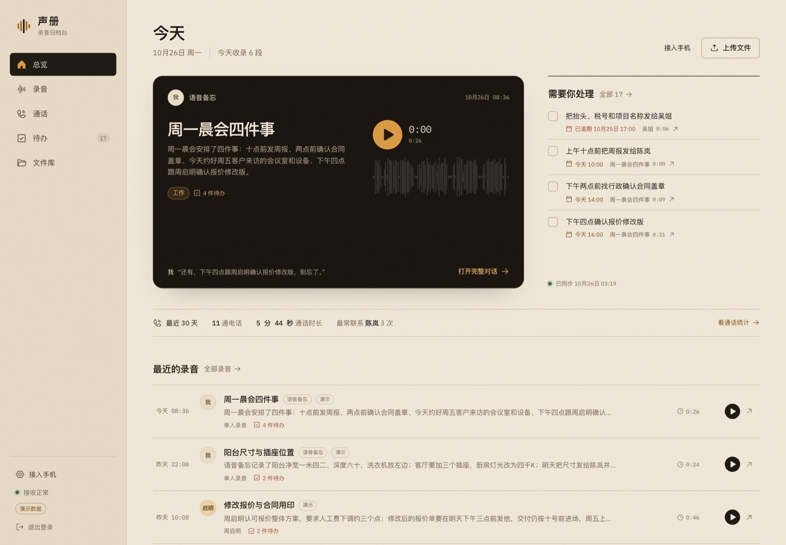
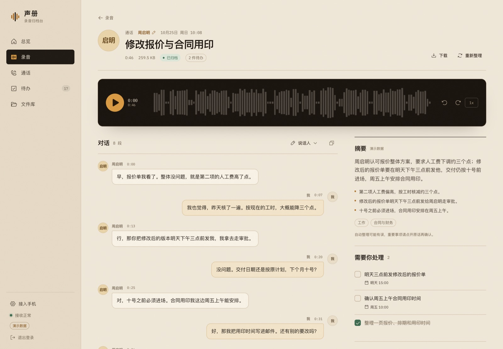
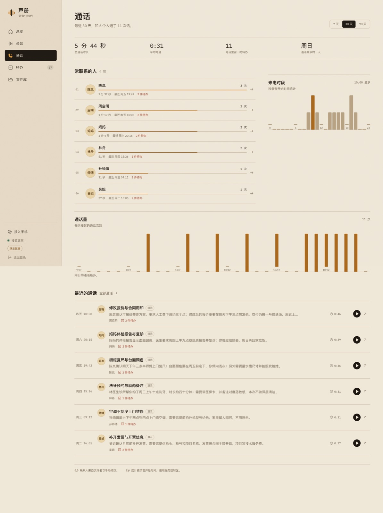
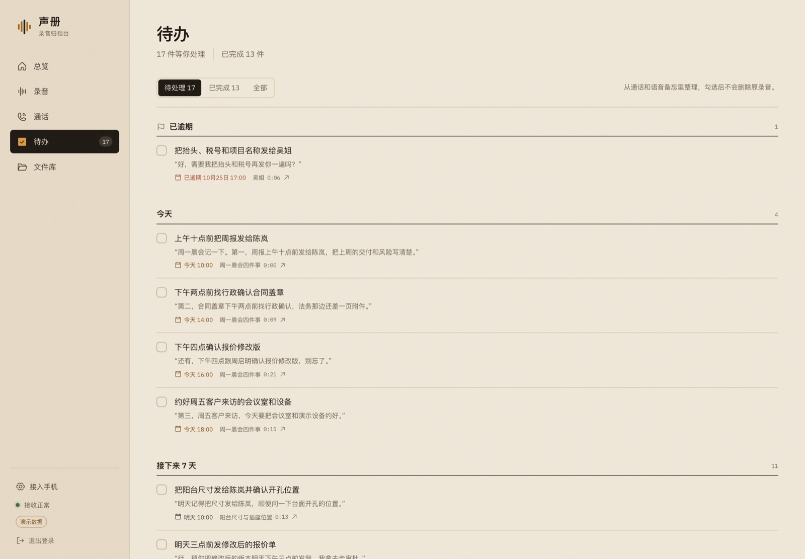
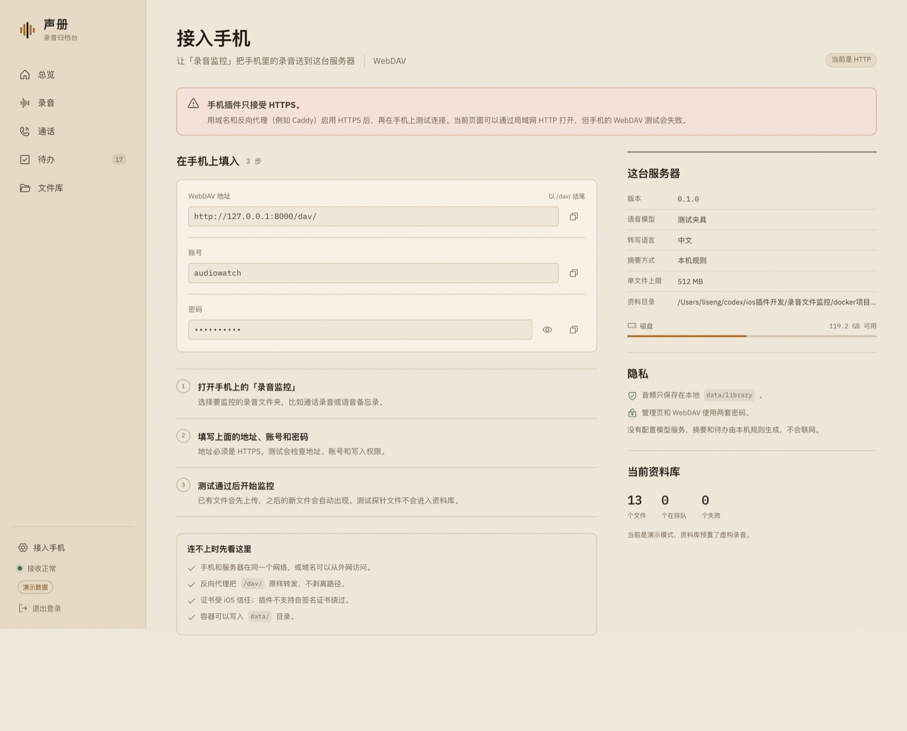
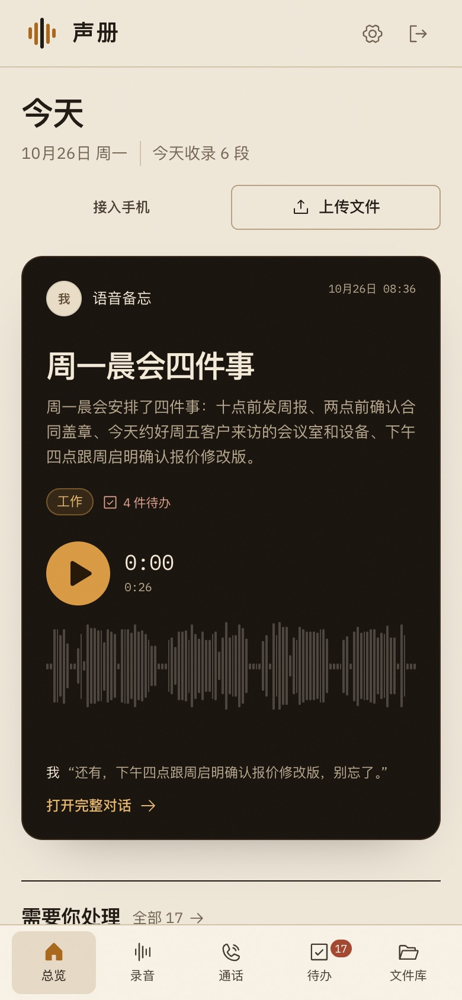

# 声册 / Shengce

[](https://github.com/Ay-cc-coder/shengce/actions/workflows/docker.yml)

把 iPhone 上传的通话录音和语音备忘收进一台自己的服务器，自动整理成可以回听的对话、摘要和待办，并按联系人看清谁在频繁联系你。



## 能做什么

- **接收**：内置 WebDAV，手机上的「录音监控」插件直接把文件传进来；同名覆盖，探针文件不进入资料库。
- **分类**：区分通话录音、语音备忘、普通音频、文档、图片、视频、压缩包；文档按内容给出分类标签。
- **转写**：使用 faster-whisper 在本机转写中文，生成带时间码的对话。
- **对话**：按微信聊天框的方式左右展示；点击时间码跳转到对应音频；自动分段后可手动改名或交换双方。
- **摘要**：生成 2–3 句摘要、要点和主题；可选接入 OpenAI 兼容模型，不配置则完全在本机按规则整理。
- **待办**：从“需要你做的事”里抽出待办，支持勾选完成、截止日期、跳回原话时间点。
- **通话统计**：常联系人排行、通话量趋势、来电时段、单日通话分布；支持 7 / 30 / 90 天。
- **文件库**：所有上传文件按类型归档，音频可直接播放，其他文件可下载。
- **运行状态**：WebUI 实时显示容器 CPU、内存、NAS 内存、队列、GPU 显存/利用率和当前识别设备。
- **私人部署**：单用户密码登录，数据只保存在 `data/`；默认不向外部服务发送任何内容。

| 录音详情：对话与摘要 | 通话统计：频繁联系的人 |
| --- | --- |
|  |  |

| 待办 | 接入手机 |
| --- | --- |
|  |  |

手机上的布局会收成单列，播放条停在底部导航之上：



> 截图里的联系人和对话均为虚构演示数据，界面中的“演示”标记也会出现在这些录音上。

## 工作方式

```text
iPhone「录音监控」
   │  HTTPS WebDAV（PUT / PROPFIND / MKCOL）
   ▼
[Caddy] ──► 声册 app（FastAPI）
                │
                ├─ data/library/        原始文件，保持目录与文件名
                ├─ data/shengce.db      SQLite：文件、对话、摘要、待办、联系人
                ├─ data/models/         faster-whisper 模型
                │
                ├─ 处理线程：分类 → 读音频 → 转写 → 对话分段 → 摘要/待办
                └─ 扫描线程：每 5 分钟补收直接放进 library 的文件
```

处理是单线程队列，默认一次处理一个文件。手机上传统绪不会被阻塞；WebUI 里会显示“排队 / 读取 / 转写 / 整理”。

## 快速开始

### 1. 启动

主 compose 文件就是 [`docker-compose.yml`](docker-compose.yml)，它只做三件事：拉取公开镜像、映射 3000 端口、挂载 `./data`。**不使用 80/443，也不启动 Caddy。**

```bash
cd docker项目
# 先打开 docker-compose.yml，修改 ADMIN_PASSWORD 和 DAV_PASSWORD
docker compose up -d
```

打开 `http://localhost:3000`。

- 第一次会拉取 `ghcr.io/ay-cc-coder/shengce:latest`，镜像较大，需要等几分钟；
- 首次转写会下载 Whisper 模型到 `data/models/`；
- 没有 `.env` 文件，也没有构建步骤；
- 如果 3000 被占用，改 `docker-compose.yml` 里的 `"3000:8080"` 即可。

### 2. 在手机上接入

1. 手机安装配套的「录音监控」插件（本仓库上一级的 iOS 项目）。
2. 打开 App，填写：
   - WebDAV 地址：`https://你的域名/dav/`
   - 账号：`docker-compose.yml` 里的 `DAV_USERNAME`，默认 `audiowatch`
   - 密码：`docker-compose.yml` 里的 `DAV_PASSWORD`
3. 点“测试连接”。地址、账号、写入权限三项都通过后，选好录音文件夹并开始监控。
4. 已有文件会先上传；之后出现的新文件会自动进来。测试用的 `audiowatch-connection-test-*.txt` 不会写入资料库。

> **手机插件只接受 HTTPS。** `http://局域网IP:3000` 可以打开 WebUI，但手机 WebDAV 测试会失败。

### 3. HTTPS：优先复用已有反向代理

**主 compose 不监听 80/443。** 大多数 NAS 的 80/443 已经被管理页面或反向代理占用，直接让已有反代把域名转发到 `127.0.0.1:3000` 即可：

```text
https://record.example.com  →  http://127.0.0.1:3000
```

反代要保留 `/dav/` 路径、允许 512 MB 上传、设置 `X-Forwarded-Proto: https`。完整的 Nginx 示例和 fnOS 说明见 [docs/fnos.md](docs/fnos.md)。

只有确认 80/443 空闲时，才叠加可选的 Caddy：

```bash
# 先修改 docker-compose.tls.yml 里的 DOMAIN
docker compose -f docker-compose.yml -f docker-compose.tls.yml up -d
```

如果 80/443 已被占用，这一步会报 `port is already allocated`；**不要用改 Caddy 端口的办法解决证书问题**，改用已有反代、Cloudflare Tunnel 或 Tailscale。

### 从源码构建（可选）

只有想自己编译镜像时才需要完整仓库：

```bash
git clone https://github.com/Ay-cc-coder/shengce.git
cd shengce
cp .env.example .env
# 修改 .env
docker compose -f docker-compose.build.yml up -d --build
```

### 在 fnOS 上用 Compose 安装

fnOS 直接使用根目录的 `docker-compose.yml`，不需要单独的 fnOS 文件：

```bash
git clone https://github.com/Ay-cc-coder/shengce.git
cd shengce
# 修改 docker-compose.yml 里的两个密码
docker compose up -d
```

默认只占用 3000，不影响 NAS 的 80/443。手机 HTTPS 推荐复用 fnOS 已有的 443 反向代理；详细步骤见 [docs/fnos.md](docs/fnos.md)。

## 演示数据

想在没接手机前先看看界面：

1. 把 `docker-compose.yml` 里的 `DEMO_MODE` 改成 `"1"`；
2. 确认 `data/` 是空的；
3. 执行：

```bash
docker compose up -d --force-recreate
```

首次在空资料库启动时，会写入 13 段虚构录音、6 位联系人和 30 条待办（17 条未完成、13 条已完成），并复制演示音频。演示音频用 macOS 中文语音合成，内容纯属虚构。

重置演示：

```bash
docker compose down
mv data data.backup
mkdir data
# 保持 DEMO_MODE=1
docker compose up -d --force-recreate
```

## 配置

日常安装只需要改 `docker-compose.yml` 里的 `environment`：

```yaml
environment:
  TZ: Asia/Shanghai
  ADMIN_PASSWORD: "change-me"   # 必须改
  DAV_USERNAME: audiowatch
  DAV_PASSWORD: "change-me"     # 必须改
  WHISPER_MODEL: small
  DEMO_MODE: "0"
```

更多变量可在同一个 `environment` 下追加；源码构建方式则写在 `.env` 里。

| 变量 | 默认 | 说明 |
| --- | --- | --- |
| `ADMIN_PASSWORD` | 无 | WebUI 管理员密码；compose 中必须修改 |
| `DAV_USERNAME` | `audiowatch` | 手机 WebDAV 账号 |
| `DAV_PASSWORD` | 无 | 手机 WebDAV 密码；compose 中必须修改 |
| `APP_PORT` | `3000` | 宿主机端口；主 compose 直接写在 `ports` 里 |
| `APP_BIND` | `0.0.0.0` | 仅源码构建文件使用；只用反代时可改 `127.0.0.1` |
| `PUBLIC_URL` | 空 | 对外地址；用于“接入手机”页显示正确 URL |
| `TZ` | `Asia/Shanghai` | 统计和“今天”的时区 |
| `WHISPER_MODEL` | `small` | `base` / `small` / `medium` / `large-v3` / `large-v3-turbo` |
| `WHISPER_LANGUAGE` | `zh` | 转写语言 |
| `WHISPER_DEVICE` | `cpu` | 使用 GPU 时由 `docker-compose.gpu.yml` 设为 `cuda` |
| `WHISPER_DEVICE_INDEX` | `0` | 多卡时选择第几张 NVIDIA 卡 |
| `WHISPER_COMPUTE_TYPE` | `int8` | CPU 推荐 `int8`；GPU 可用 `float16` |
| `WHISPER_CPU_THREADS` | `2` | CTranslate2 使用的 CPU 线程数；NAS 上别设太高 |
| `WHISPER_PROMPT` | 空 | 默认关闭；只有需要加人名/专业词时才填，过长可能被模型重复 |
| `ASR_ENGINE` | `faster` | `faster` 正常转写；`fake` 读取夹具，仅供开发 |
| `LLM_BASE_URL` | `https://api.deepseek.com/v1` | OpenAI 兼容接口地址 |
| `LLM_API_KEY` | 空 | 填了才启用模型摘要 |
| `LLM_MODEL` | `deepseek-chat` | 模型名 |
| `MAX_UPLOAD_MB` | `512` | 单文件上限 |
| `DEMO_MODE` | `0` | 空库时写入演示数据 |
| `START_WORKER` | `1` | 设为 `0` 暂停处理队列，保留 WebUI 和上传 |
| `SHOW_DAV_PASSWORD` | `1` | “接入手机”页是否显示 WebDAV 密码 |
| `SECURE_COOKIES` | `0` | 强制 Cookie 只走 HTTPS；反向代理已设置 `X-Forwarded-Proto` 时通常不用 |

### 用模型生成摘要

不配置模型也能用：摘要、要点和待办由本机关键词/句式规则生成。

配置后，把**当前录音的转写文本、文件名、联系人候选和录音日期**发送给你指定的模型服务，不发送音频。示例：

```dotenv
LLM_BASE_URL=https://api.deepseek.com/v1
LLM_API_KEY=sk-...
LLM_MODEL=deepseek-chat
```

保存后重启容器，在录音详情页点“重新整理”即可让已有录音重新走模型。可以用任何 OpenAI 兼容服务，包括本地 vLLM / Ollama 的兼容网关。

### 关于 Whisper

默认 `small` + CPU `int8`，在普通小服务器上可用，但长录音会慢。中文电话录音如果追求更高质量，可换 `medium`；首次切换会重新下载模型。模型缓存在 `data/models/`，重启不会重复下载。

有 NVIDIA 显卡时，使用下面的 `:cuda` 镜像；在 WebUI「运行状态」页可以直接选择 GPU 和模型。

## 资源占用、GPU 与 NAS 稳定性

### 两个镜像

| 镜像 | 用途 |
| --- | --- |
| `ghcr.io/ay-cc-coder/shengce:latest` | 默认 CPU 镜像 |
| `ghcr.io/ay-cc-coder/shengce:cuda` | NVIDIA CUDA 镜像，支持 RTX 3060 等 |

CPU 镜像不能通过改环境变量使用 GPU，因为它没有 CUDA runtime。要使用显卡，必须切换到 `:cuda` 镜像，并在 compose 里加上 `gpus: all`。

### GPU 加速（NVIDIA）

前提：

- NAS 已安装 NVIDIA 驱动；
- Docker 已安装 NVIDIA Container Toolkit，并且下面这条命令能输出显卡：

```bash
docker run --rm --gpus all nvidia/cuda:12.4.1-base-ubuntu22.04 nvidia-smi
```

然后叠加 GPU 配置：

```bash
docker compose   -f docker-compose.yml   -f docker-compose.gpu.yml   up -d
```

`docker-compose.gpu.yml` 会：

- 使用 `ghcr.io/ay-cc-coder/shengce:cuda`；
- 加 `gpus: all`；
- 设置 `WHISPER_DEVICE=cuda`、`WHISPER_COMPUTE_TYPE=float16`；
- 把 CPU/内存上限放宽到 4 核 / 4 GB。

启动后打开 `http://NAS的IP:3000/system`：

- 会列出 NVIDIA 显卡、显存、利用率、温度；
- 可以选择 GPU 或 CPU；
- 可以选择 `base` / `small` / `medium` / `large-v3`；
- 切换后从下一段录音开始使用新模型，正在处理的文件不受影响。

Intel / AMD 核显（例如 UHD 730）暂不被 faster-whisper 使用，页面会明确标注。GPU 模式下 CPU 只做预处理，建议保留内存上限；如果追求最快速度，可以把 `docker-compose.gpu.yml` 的 `cpus` 调高或删掉。

### CPU 默认限制

默认 `docker-compose.yml` 已经加了保护：

```yaml
cpus: "2.0"
mem_limit: "3g"
mem_reservation: "768m"
pids_limit: 256
environment:
  WHISPER_CPU_THREADS: "2"
  OMP_NUM_THREADS: "2"
  MKL_NUM_THREADS: "2"
  OPENBLAS_NUM_THREADS: "2"
```

`cpus` / `mem_limit` 是 Docker 的硬限制：超过内存时只会杀掉声册容器，而不是拖死整台 NAS。

### NAS 已经卡死或死机过

先别再让它自动处理：

```bash
docker compose stop shengce
docker update --restart=no shengce
```

然后在 NAS 上检查：

```bash
docker inspect shengce --format '{{.State.OOMKilled}} {{.State.ExitCode}}'
dmesg -T | grep -i -E 'oom|killed process' | tail -30
free -h
df -h
docker stats --no-stream
```

如果 `OOMKilled=true`，或内核日志出现 `Out of memory: Killed process`，基本就是内存被吃满。

### 怎么降负载

1. 先把 `START_WORKER` 设为 `"0"`，重启容器；此时 WebUI 和上传正常，但不转写。
2. 把 `WHISPER_MODEL` 从 `small` 换成 `base`，再考虑恢复；`medium` 只在性能足够的机器上用。
3. 把 `WHISPER_CPU_THREADS`、`OMP_NUM_THREADS` 调到 `1` 或 `2`。
4. 把 `mem_limit` 调低（例如 2g），确认模型还能加载；如果 OOM，换 `base`。
5. 大量历史文件分批导入，别一次把几千小时音频丢进队列。
6. 稳定后再把 `START_WORKER` 改回 `"1"`。

不要用关闭 swap 或无限增加 swap 来“解决”内存问题；优先限制容器和降低模型。

## 文件与处理规则

- 保留手机上传时的文件名和子目录；不转码、不删除原文件。
- 同名文件覆盖后重新整理。
- 跳过隐藏文件、`._*`、`.tmp`、`.part`、`.crdownload`、WebDAV 探针。
- 录音时间优先取文件名里的日期时间（如 `2026-10-24 19-42`），取不到才用文件修改时间，再取不到用上传时间。
- 联系人名优先从文件名中的“通话录音 + 姓名”推断；也可以在任何录音详情页手动修改。
- 文档分类读取 PDF / DOCX / 文本的前几页，按合同、账单、证件、医疗、工作、家居、出行等标签归类；不会调用外部 OCR。

### 对话与待办的可信度

- faster-whisper 只做语音识别，不做说话人分离。默认按停顿和句末语气把通话切成左右两方，清楚标为“自动分段”。
- 详情页可以给两个说话人改名或交换左右。**如果双方认反了，改一次即可。**
- 待办由本地规则或模型抽取，可能把对方要办的事也算进来。页面底部有提醒；勾选前请点回原话确认。
- 目前不读取运营商通话详单，统计的是“被收进资料库的通话录音”。

## 数据与备份

```text
data/
├── library/              原始文件（按手机上的目录结构）
├── shengce.db            SQLite 数据库
├── models/               Whisper 模型
├── admin-password.txt    自动生成的管理密码（仅未设置 env 时）
├── dav-password.txt      自动生成的 WebDAV 密码（仅未设置 env 时）
└── session-secret        登录 Cookie 签名密钥
```

备份时停止容器，直接复制整个 `data/`。恢复时把 `data/` 放回同一位置再启动。

## 安全

- 默认就是单用户密码登录；不要把 3000 直接暴露到公网。
- 管理台和 WebDAV 使用两套密码；建议都改成长随机值。
- 手机端务必使用 HTTPS；Caddy 会自动管理证书。
- 登录有简单的失败次数限制；Cookie 为 HttpOnly、SameSite=Lax。
- 日志不记录密码、转写正文或音频内容。
- 未配置 LLM 时不会联网；配置后只发送当前录音的文本。请自行评估模型服务商的隐私条款。

这是一个面向个人/家庭的单用户工具，**没有多租户、分享链接或团队权限**。

## 开发

### 前端

```bash
cd web
npm ci
npm run dev        # http://127.0.0.1:5173，/api 代理到 8000
npm run typecheck
npm run build
```

### 后端

```bash
python3 -m venv .venv
.venv/bin/pip install -r requirements-dev.txt
DATA_DIR=./data \
ADMIN_PASSWORD=dev-pass \
DAV_PASSWORD=dev-dav \
DEMO_MODE=1 \
ASR_ENGINE=fake \
START_WORKER=0 \
.venv/bin/uvicorn app.main:create_app --factory --reload --port 8000
```

`ASR_ENGINE=fake` 只用于开发；它会读取 `demo/data/*.json` 里的转写夹具，或在没有夹具时给出占位转写。

### 测试

```bash
.venv/bin/python -m pytest -q
cd web && npm run typecheck && npm run build
```

当前测试覆盖：登录与权限、演示数据、录音列表/详情/搜索、音频 Range、说话人修改、待办勾选、文本上传与文档分类、统计范围、WebDAV PROPFIND/PUT/MKCOL/DELETE、探针忽略、路径穿越、文件名日期/联系人解析。

### 截图

本地启动前后端后：

```bash
cd web
npm run shoot
```

脚本使用本机 Google Chrome（Playwright Core），把截图写入 `docs/screenshots/`。

## API 一览

| 方法 | 路径 | 说明 |
| --- | --- | --- |
| `GET` | `/api/overview` | 总览（最新录音、待办、30 天统计） |
| `GET` | `/api/recordings` | 录音列表，支持 `q` / `kind` / `contact_id` / 分页 |
| `GET` | `/api/recordings/{id}` | 录音详情、对话、摘要、待办 |
| `PATCH` | `/api/recordings/{id}` | 修改联系人 / 标题 |
| `PATCH` | `/api/recordings/{id}/speakers` | 修改或交换说话人 |
| `POST` | `/api/recordings/{id}/reprocess` | 重新排队整理 |
| `GET` | `/api/recordings/{id}/audio` | 音频流（支持 Range） |
| `GET` | `/api/actions` | 待办列表 |
| `PATCH` | `/api/actions/{id}` | 完成 / 取消完成 |
| `GET` | `/api/stats?days=30` | 通话统计 |
| `GET` | `/api/files` | 文件库 |
| `POST` | `/api/upload` | 手动上传 |
| `GET` | `/api/setup` | 接入信息 |
| `*` | `/dav/...` | WebDAV（Basic Auth） |

## 目录

```text
docker项目/
├── app/                  FastAPI、WebDAV、处理管线、SQLite
├── web/                  React + Vite 前端
├── demo/                 演示音频与转写夹具
├── scripts/              构建演示音频、截屏
├── tests/                后端测试
├── docs/                 架构说明、截图
├── Dockerfile                 CPU 镜像
├── Dockerfile.cuda            NVIDIA CUDA 镜像
├── docker-compose.yml        默认安装：拉取镜像，仅 3000
├── docker-compose.build.yml  可选：源码构建
├── docker-compose.gpu.yml    可选：NVIDIA CUDA 加速
├── docker-compose.tls.yml    可选：Caddy 80/443
├── .github/workflows/        GHCR 多架构镜像构建
├── Caddyfile
├── PRODUCT.md
└── DESIGN.md
```

## 已知限制

- 说话人分离是启发式，不是 pyannote 级别的声纹分离。
- 联系人主要靠文件名和手动修改；不会自动读取通讯录。
- 不解析运营商通话详单，不统计未上传的通话。
- 文档不做 OCR；扫描版 PDF 可能提取不到文字。
- 单线程处理；大量长录音会排队。
- LLM 摘要可能出错，重要事项以原话为准。

## 设计

界面按 `fe-design` → `ux-max` → `taste` → `polish` 的流程完成：

- 方向与令牌：[DESIGN.md](DESIGN.md)
- 产品范围与成功标准：[PRODUCT.md](PRODUCT.md)
- 处理管线与部署细节：[docs/ARCHITECTURE.md](docs/ARCHITECTURE.md)

视觉延续 iOS 端的纸色、深咖啡和琥珀色，但把“录音归档”做成了桌面上的聆听台：纸面索引、深色播放台、贯穿全站的可拖动波形，以及和音频同步的对话。
