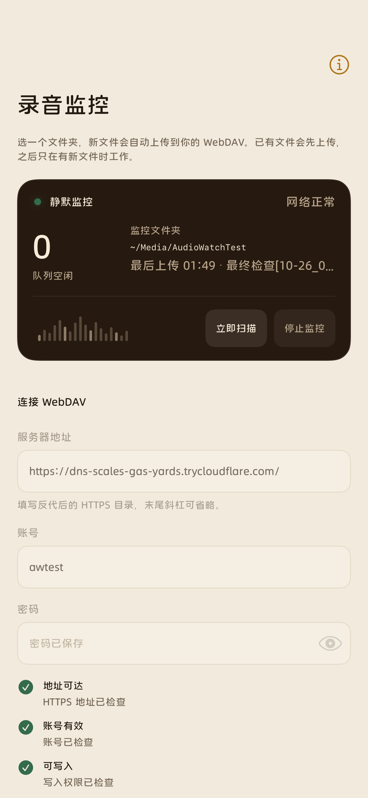
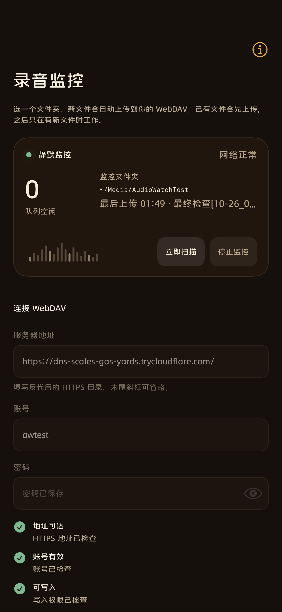
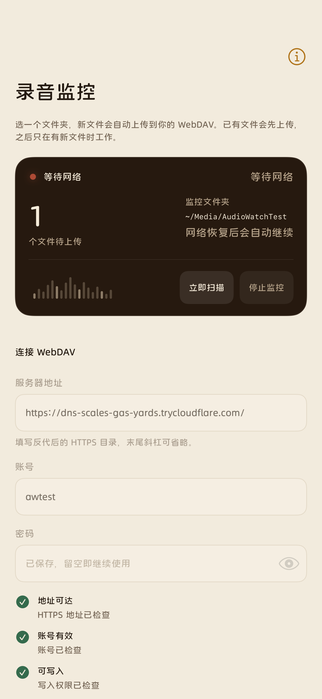
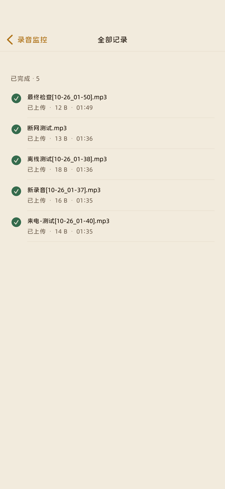
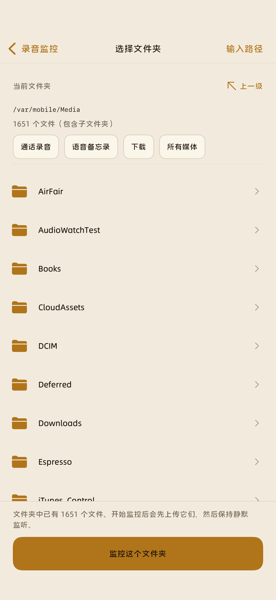

# 录音监控（RootHide）

> **本目录是 [声册 / Shengce](../README.md) 仓库的 iPhone 客户端**，服务器端在仓库根目录。

> **作者与开发方式**：项目所有者 **liseng** 负责需求、产品方向、设计审阅和实机验证；本项目代码由 **AI coding agent** 编写。详见 [AUTHORS.md](AUTHORS.md)。

一个 RootHide 越狱插件/App：选择文件夹，先验证 HTTPS WebDAV，再把已有和新文件按**原文件名**上传；断网时保留队列，网络恢复后自动继续。关闭 App 后由 root 守护进程继续工作，空闲时不轮询文件夹。



> 截图使用临时测试 WebDAV 与测试文件，仅用于展示；示例地址已失效，安装后不会预置任何服务器、账号或监控路径。

## 安装

GitHub 仓库：<https://github.com/Ay-cc-coder/shengce>  
最新 Release：<https://github.com/Ay-cc-coder/shengce/releases/tag/ios-v1.0.6>

### 安装包

[com.liseng.audiowatch_1.0.6_iphoneos-arm64e.deb](packages/com.liseng.audiowatch_1.0.6_iphoneos-arm64e.deb)

SHA-256：`b0a13031eadb6257f6e7c877f6dbb0f3a31545d038362e628e2db9348cdec5a1`

在 Sileo / Zebra / Filza 中安装上面的 `.deb`。

或 SSH：

```bash
scp -P 2222 packages/com.liseng.audiowatch_1.0.6_iphoneos-arm64e.deb \
  root@<device>:/var/tmp/
ssh -p 2222 root@<device> \
  'dpkg -i /var/tmp/com.liseng.audiowatch_1.0.6_iphoneos-arm64e.deb'
```

安装后桌面出现“录音监控”图标。包内含：

- `/Applications/AudioWatch.app`
- `/usr/local/libexec/AudioWatchDaemon`
- `/Library/LaunchDaemons/com.liseng.audiowatch.daemon.plist`

支持 RootHide / Dopamine（iOS 15+，在 iPhone 14 Pro Max / iOS 16.3 实机验证）。

## 第一次使用

1. 打开 App。
2. 填写 **HTTPS** WebDAV 目录，例如 `https://dav.example.com/recordings/`。
3. 填写账号和密码，点“测试连接”。
4. 测试会依次检查：HTTPS 地址可达、账号有效、可写入（PUT 一个探针文件后 DELETE）。三项通过才会解锁开始按钮。
5. 选择监控文件夹（支持快捷位置、上一级、手动输入路径）。文件夹浏览器会同时列出子文件夹和**所有格式**的文件；点文件可查看格式、大小和路径。
6. 点“开始监控”。**只有测试通过并点击开始后，已有文件才会开始上传。**

> 在文件夹浏览器里选中文件夹本身即可；列表里的文件不需要逐个选择，上传监听的是整个文件夹。

App 会保留你填写的服务器、账号、文件夹和密码；测试遗留的临时地址会被迁移清理。旧文件夹不存在时，选择器会回到 `/var/mobile/Media`。

开始后：

- 文件夹里已有的文件会先上传；
- 之后只有新文件出现时才唤醒守护进程；
- 文件名与子目录结构保持不变；
- 本地文件不会被删除；服务器同名文件会被覆盖；
- 从后台把 App 划掉不会停止守护进程；要停止监听请回到 App 点“停止监控”。

## 断网与重试

- 上传失败且属于网络问题时，文件进入队列并显示“等待网络”；
- 守护进程用 `SCNetworkReachability` 等待网络，不在离线时反复轮询；
- 网络恢复后自动继续，App 关闭也不影响；
- 账号/权限/空间等永久错误会显示“需要检查”，修正后重新测试并开始即可重试。

## 文件规则

- 递归包含子目录；子目录在服务器上按需 `MKCOL`。
- 跳过隐藏文件、`._*`、`.tmp`、`.part`、`.crdownload` 等临时文件。
- 不改名、不转码、不删除本地文件。
- 只接受 HTTPS；账号密码只保存在本机，不写入日志。密码首次输入后会保存，下次打开自动使用，无需重复输入。
- 所有文件（不仅是音频）都会按上述规则上传；可用文件夹范围来控制。

## 与旧版 WebDAVMP3Sync 共存

如果设备里仍安装着 `com.iseng.webdavmp3sync`，它的守护进程也会处理录音文件夹，可能造成重复上传或文件被旧插件删除。**建议先在 Sileo 卸载旧插件，或至少停用其守护进程**，再使用本插件。新插件使用独立的 `com.liseng.audiowatch` 包和独立数据目录。

## 发布到 GitHub

iOS 端位于声册仓库的 `ios/` 目录：

- 仓库：<https://github.com/Ay-cc-coder/shengce>
- Release：<https://github.com/Ay-cc-coder/shengce/releases/tag/ios-v1.0.6>

后续发版（在仓库根目录执行）：

```bash
git add ios/
git commit -m "release: 录音监控 1.0.7"
git push origin main
git tag ios-v1.0.7
git push origin ios-v1.0.7
```

推送 `ios-v*` 标签后，根目录的 [`.github/workflows/ios-release.yml`](../.github/workflows/ios-release.yml) 会自动创建 Release 并附上 `ios/packages/*.deb`。更完整的说明见 [docs/PUBLISH.md](docs/PUBLISH.md)。

## 构建

```bash
cd ios
make clean
make -j1 FINALPACKAGE=1
make package FINALPACKAGE=1
```

- 需要 RootHide Theos（`THEOS=~/theos`）与 iPhoneOS SDK。
- 刻意使用 `-j1`：Theos 的递归 make 在并行模式下可能死锁。
- 架构：App 与 daemon 均为 arm64 + arm64e；包架构 `iphoneos-arm64e`。
- 设计说明见 [DESIGN.md](DESIGN.md)，产品说明见 [PRODUCT.md](PRODUCT.md)，技术细节见 [docs/ARCHITECTURE.md](docs/ARCHITECTURE.md)。
- 图标源文件在 `artwork/音频.svg`；重新生成 PNG 需要 Node.js 与 `sharp`：

```bash
npm install sharp
NODE_PATH=./node_modules node tools/make_icons.js
```

## 界面

| | |
| --- | --- |
|  |  |
|  |  |
|  |  |

## 许可证

MIT，见 [LICENSE](LICENSE)。如果你希望使用 GPL 或其他许可证，请在首次发布前替换。

## 故障排查

| 现象 | 处理 |
| --- | --- |
| 守护进程未连接 | 重装插件，或 `launchctl bootstrap system /Library/LaunchDaemons/com.liseng.audiowatch.daemon.plist` |
| 测试提示“无法连接守护进程” | 确认守护进程在运行，端口 `47821` 未被占用 |
| 测试提示“HTTPS 证书验证失败” | 使用受信任证书；不支持自签名证书绕过 |
| 测试提示“账号没有写入权限” | 检查 WebDAV 目录权限、反向代理规则 |
| 一直等待网络 | 检查 iOS 网络、WebDAV 主机与反向代理；查看 `/var/mobile/Library/Logs/AudioWatch.log` |
| 旧插件冲突 | 卸载 `com.iseng.webdavmp3sync` 或停用其 daemon |
| 想清空队列/配置 | 停止监控后删除 `/var/mobile/Library/Preferences/com.liseng.audiowatch/`，重启 daemon |

## 验证记录（实机）

- 安装后桌面注册与启动：通过。
- 已有文件初始上传：通过（4 个）。
- 新文件静默上传：通过。
- 中文、括号、emoji 文件名原样保留：通过。
- 子目录与空格文件名：通过。
- 断网（不可达主机）显示“等待网络”：通过。
- 恢复网络/配置后自动上传：通过。
- 关闭 App 后守护进程继续：通过。
- 浅色、深色、文件夹浏览器、全部记录：截图见 `docs/screenshots/`。
